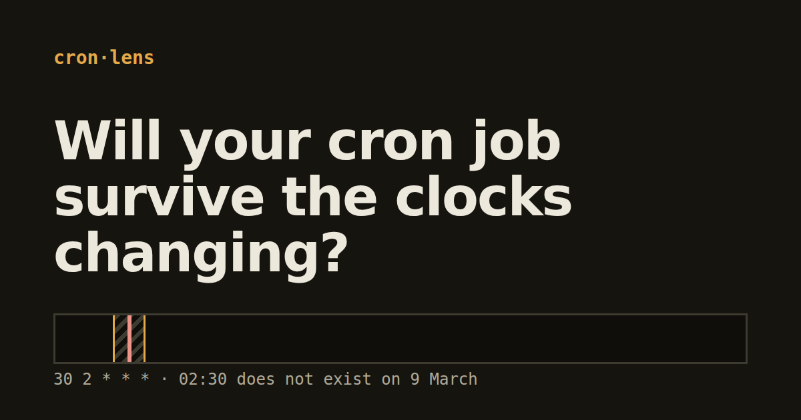

# Cronlens

**Will your cron job survive the clocks changing?** Paste a cron expression, pick a time zone, and see which runs a daylight-saving change skips or repeats.

Live: https://cronlens.pages.dev



## What it does

- Plain-English reading of a five-field cron expression.
- The next ten runs, each with local time, UTC offset and UTC time.
- Every clock change in the next 12 months, with a 24-hour strip that shows the hour that disappears (or repeats) and where your runs land in it.
- A verdict: how many clock changes skip or repeat a run.
- Shareable links: the expression and zone live in the URL hash.

Everything runs in your browser. No server, no analytics, no network after load.

## Run it

```bash
npm install
npm run dev        # http://localhost:5173
npm test           # unit tests
npm run test:e2e   # browser tests + accessibility audit
npm run build
```

## How it works

Times are handled as instants and as wall readings (the clock on the wall). `src/lib/zone.ts` asks `Intl.DateTimeFormat` for the zone offset at an instant, maps a wall reading back to zero, one or two instants, and finds clock changes by scanning in 12-hour steps and bisecting. `src/lib/plan.ts` checks every minute of the skipped or repeated range against the schedule. No tz database is shipped, so rules come from your browser.

Cronlens reports facts about the clock. How a given scheduler (Vixie cron, systemd, Kubernetes, cloud services) treats a skipped or repeated time differs: check yours.

Syntax: standard five-field crontab, names, lists, ranges, steps, `@daily`-style macros. Day-of-month and day-of-week both restricted means either may match. Quartz syntax and seconds are not supported.

## Licence

MIT
